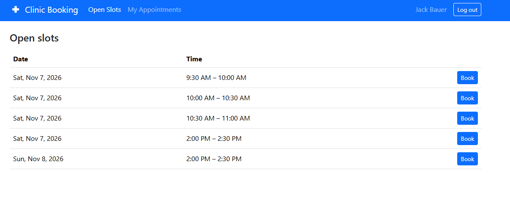
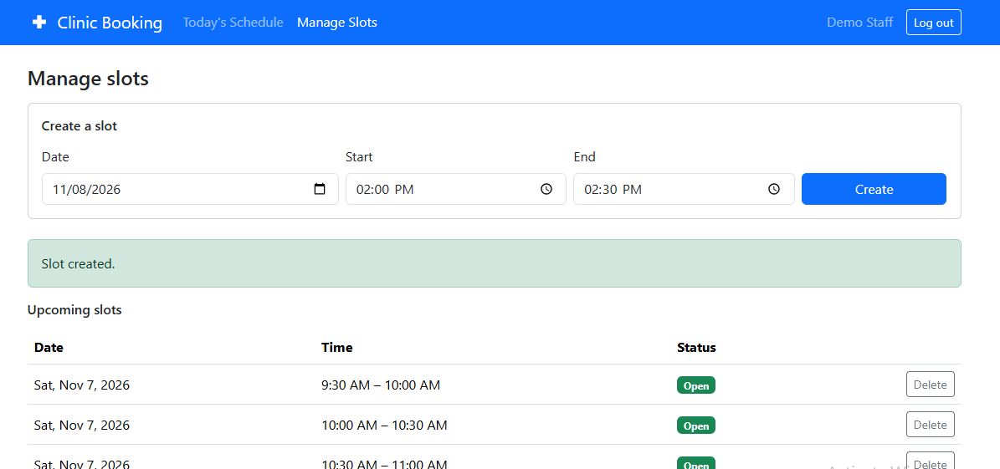

# Clinic Booking System

A full-stack appointment booking app for a small clinic. Patients browse open time slots and book or cancel appointments. Clinic staff create and manage slots and see today's schedule.

**Live demo:** https://clinic-booking1-app.netlify.app
**API:** https://clinic-booking-api-07do.onrender.com/api/health

> **Heads up:** the backend runs on a free hosting tier that goes to sleep when idle. The first request after a quiet period can take about a minute to wake up. After that, everything is fast.

## Try it

| Role | How to sign in |
|---|---|
| Patient | Click **Register** and create an account (patients can self-register) |
| Staff | Email `staff@demo.com`, password `DemoStaff123` |

This is a demo deployment. Please don't enter real personal data.

A good way to explore: sign in as staff and create a slot for tomorrow, then register as a patient (a private window helps) and book it. Then go back to the staff view and cancel it with a reason.

## Screenshots

<!-- Add 3-4 screenshots to a /screenshots folder and link them here, for example: -->
<!--  -->
<!--  -->

## Features

**Patients**
- Register and log in
- View open slots and book one
- See "My appointments" (booked and cancelled, with reasons)
- Cancel an appointment with a reason

**Clinic staff**
- Create and delete time slots
- See which slots are open or booked, and by whom
- See today's schedule
- Cancel any booking with a reason

**Rules the system enforces**
- A slot can never be booked by two people at once
- Patients can only cancel their own appointments; staff can cancel any
- Slots can't be created in the past, and a slot's end must be after its start
- Cancelled slots become bookable again, and the history is kept

## Tech stack

| Layer | Technology |
|---|---|
| Frontend | React (Vite), React Router, Bootstrap 5 |
| Backend | Node.js, Express |
| Database | PostgreSQL |
| Auth | JWT, passwords hashed with bcrypt (bcryptjs) |
| Hosting | Netlify (frontend), Render (backend), Neon (database) |

## How it's built

```
React app  --HTTP/JSON-->  Express REST API  --SQL-->  PostgreSQL
 (Netlify)                    (Render)                   (Neon)
```

```
clinic-booking/
├── client/                 React frontend
│   └── src/
│       ├── api/            fetch helper that attaches the JWT
│       ├── context/        AuthContext (who is logged in)
│       ├── components/     Navbar, ProtectedRoute, CancelModal
│       ├── hooks/          useFetch
│       └── pages/          one file per screen
└── server/                 Express API
    ├── db/schema.sql       database schema
    ├── scripts/            createStaff, seedSlots, smoke test
    └── src/
        ├── config/         database connection pool
        ├── middleware/     authenticate, requireRole
        ├── controllers/    request logic and SQL
        └── routes/         URL definitions
```

## Design decisions

**Double-booking is prevented by the database, not just the code.** A partial unique index allows only one `booked` appointment per slot. If two patients click the same slot at the same moment, PostgreSQL accepts one insert and rejects the other, and the API turns that into a clear `409 Conflict` message. Checking "is it free?" in JavaScript before inserting would leave a race condition.

**A slot's availability is derived, not stored.** There is no `is_booked` flag that could drift out of sync. A slot is open when no active appointment exists for it. Cancelled appointments stay in the table as history, which is why a cancelled slot reappears automatically.

**Permissions are enforced on the server.** The React app hides pages by role for a better user experience, but the real checks are the `authenticate` and `requireRole` middleware on every protected route. Cancelling is a single `UPDATE` whose `WHERE` clause includes the ownership check, and the API returns `404` rather than `403` so people can't probe for other users' appointment IDs.

**Staff accounts can't be self-registered.** The public register route always creates a patient. Staff are created by an administrator with a script.

**Timezone-safe "today's schedule".** Times are stored as UTC (`TIMESTAMPTZ`), and the "today" boundary is computed in the clinic's timezone (configurable), so it stays correct when the server runs in UTC.

**Constraints as a safety net.** Role and status values use `CHECK` constraints, emails are unique case-insensitively, and foreign keys protect appointment history.

## API overview

| Method and path | Who | Purpose |
|---|---|---|
| `POST /api/auth/register` | public | Create a patient account |
| `POST /api/auth/login` | public | Log in and receive a JWT |
| `GET /api/auth/me` | logged in | Get the current user |
| `GET /api/slots` | logged in | List open, bookable slots |
| `GET /api/slots/all` | staff | List upcoming slots with booking status |
| `POST /api/slots` | staff | Create a slot |
| `DELETE /api/slots/:id` | staff | Delete a slot with no booking history |
| `POST /api/appointments` | patient | Book a slot |
| `GET /api/appointments/mine` | patient | List my appointments |
| `GET /api/appointments/today` | staff | Today's schedule |
| `PATCH /api/appointments/:id/cancel` | patient (own) or staff | Cancel, with a required reason |

## Run it locally

**You need:** Node.js 20+ and PostgreSQL.

1. **Clone and install**
   ```bash
   git clone https://github.com/Moneybank10/clinic-booking.git
   cd clinic-booking
   cd server && npm install
   cd ../client && npm install
   ```

2. **Create the database** (for example `clinic_booking`) and run `server/db/schema.sql` against it.

3. **Configure the backend.** Copy `server/.env.example` to `server/.env` and fill it in (database URL, a long random `JWT_SECRET`, and so on).

4. **Configure the frontend.** Copy `client/.env.example` to `client/.env`. It contains `VITE_API_URL=http://localhost:5000/api`.

5. **Create a staff account**
   ```bash
   cd server
   node scripts/createStaff.js "Nurse Ada" ada@clinic.com StaffPass123
   ```
   Optionally add sample slots with `node scripts/seedSlots.js`.

6. **Start both servers** in separate terminals
   ```bash
   cd server && npm run dev
   cd client && npm run dev
   ```
   Open http://localhost:5173.

## Tests

`server/scripts/smoke.js` is an end-to-end test that runs against a live API. It checks registration, login, role permissions, slot validation, double-booking (including two simultaneous requests), cancelling, and today's schedule. It creates its own temporary users and removes them afterwards.

```bash
cd server
npm run dev      # in one terminal
npm run smoke    # in another
```

Run it against your **local** database, not the demo deployment.

## Known limitations and future improvements

- A slot that has ever had a booking can't be deleted, because history is protected by a foreign key. A `closed` flag would let staff hide slots instead.
- The JWT is stored in `localStorage`. An httpOnly cookie would be safer against XSS.
- Staff create slots one at a time. Bulk creation (for example "every 30 minutes, 9 to 5") would save time.
- Single clinic calendar only. Multiple doctors would add a `doctors` table and per-doctor slots.
- Sign-in with Google, email or SMS reminders, and automated unit tests are natural next steps.

## Author

Built by Taofeek ([@Moneybank10](https://github.com/Moneybank10)) as a portfolio project.